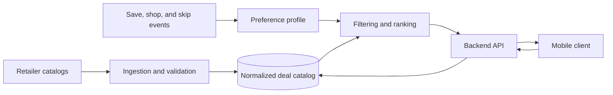

# Steals

**A private startup project for finding fashion deals that are current, relevant, and actually available.**

Steals turns discount shopping into a personalized discovery feed. Instead of showing every sale, it filters for product relevance, availability, size, and deal quality, then learns from lightweight shopper feedback.

The production implementation is private while the product is being evaluated as a startup. This repository is a public, code-free case study of the product decisions and engineering approach.

## The problem

Deal discovery is usually noisy: discounts may be stale, sizes may be unavailable, and recommendation feeds often optimize for clicks rather than whether someone can purchase the item. Early research pointed to deal validity and missing context as the largest barriers to trust.

Steals focuses on three questions:

1. Is the item still available?
2. Is the discount meaningful?
3. Is it relevant to this shopper?

## Product validation

| Stage | Result |
| --- | --- |
| Customer discovery | 18 interviews with Georgia Tech students |
| Usability testing | 8 participants testing product prototypes |
| Pilot | 50 students over two weeks |
| Activation | 68% |
| Deal redemption | 44% |
| Week-two retention | 36% |

The research shifted the roadmap toward inventory freshness and merchant verification before increasingly complex personalization.

## Product experience

- Swipe-based fashion discovery
- Filters for category, budget, size, and availability
- Save and shop actions that refine future results
- Direct handoff to the retailer for checkout
- Clear pricing and availability context

## High-level architecture

The system separates catalog ingestion from request-time serving. Product data is normalized and checked before it enters the feed; shopper events update a preference profile used during filtering and ranking.

## Engineering focus

- **Freshness:** avoid showing expired or unavailable inventory
- **Hard constraints:** respect budget and size before personalization
- **Feed quality:** balance preference fit, deal strength, and result diversity
- **Cost-aware deployment:** keep the pilot inexpensive while preserving a path to automation
- **Privacy:** use minimal shopper signals and keep checkout with the retailer

## Technology overview

- React Native and Expo mobile client
- Python and FastAPI backend
- PostgreSQL-backed authentication and event storage
- Image embeddings for visual preference modelling
- Automated tests and typed mobile code

## My role

I led customer discovery, product definition, architecture, and implementation. That included interviewing prospective users, prioritizing the first trustworthy-deal experience, building the mobile and backend workflow, and using pilot behavior to revise the roadmap.

## What remains private

This showcase intentionally excludes source code, Git history, credentials, retailer lists, operational endpoints, database schemas, detailed ranking logic, affiliate integrations, and real user data.

